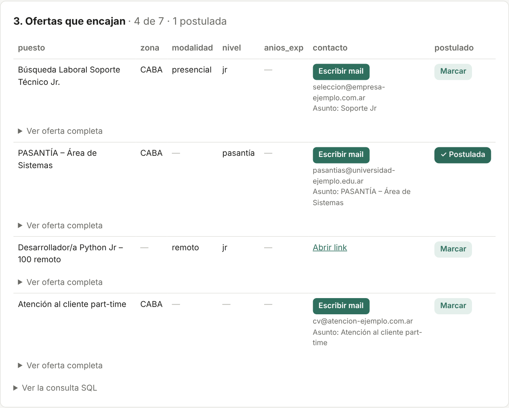

# Filtro de ofertas laborales


Lee ofertas de trabajo copiadas de canales de WhatsApp o boletines de empleo, las guarda en una base de datos SQLite y permite filtrarlas y analizarlas con SQL.

**Usalo online:** https://juliangar-dev.github.io/filtro-ofertas/ — pegás las ofertas, elegís tu perfil y te muestra las que encajan. Podés marcar a cuáles ya te postulaste (queda guardado en tu navegador), ocultarlas y abrir Gmail con el mail de postulación ya armado (destinatario, asunto que pide la oferta y tu mensaje). Todo se procesa en tu navegador; nada se sube a ningún servidor.



También hay una versión de terminal en Python (abajo).

## Cómo funciona

1. `crear_db.py` crea la base con dos tablas: `ofertas` y `habilidades`.
2. `leer.py` separa el texto en ofertas y detecta con reglas: zona, modalidad, nivel, años de experiencia, si la experiencia es excluyente, mail, link y habilidades pedidas.
3. `consultar.py` ejecuta una consulta SQL de la carpeta `consultas/` y muestra el resultado como tabla.

## Uso

1. Copiá las ofertas que te interesen (por ejemplo, desde WhatsApp Web) y pegalas en un archivo `.txt` dentro de la carpeta `datos-privados/`.
2. Ejecutá:

```
python crear_db.py
python leer.py
python consultar.py consultas/01_para_mi.sql
```

Si `datos-privados/` está vacía, el programa usa las ofertas inventadas de `datos-ejemplo/` para que puedas probarlo. Tus ofertas nunca se suben al repositorio (`.gitignore`).

## Consultas

| Archivo | Qué responde | SQL usado |
|---|---|---|
| 01_para_mi.sql | Ofertas junior en CABA sin experiencia excluyente | SELECT, WHERE, IN, IS NULL, COALESCE |
| 02_habilidades.sql | Habilidades más pedidas | JOIN, GROUP BY, COUNT |
| 03_marcar_postuladas.sql | Marca ofertas a las que ya se envió el CV | UPDATE, LIKE |
| 04_pendientes.sql | Ofertas que encajan y faltan enviar | SELECT con filtro de estado |

## Pruebas

Las reglas que separan y clasifican las ofertas tienen pruebas automáticas (`tests/`), que GitHub Actions corre en cada cambio:

```
node --test
```
